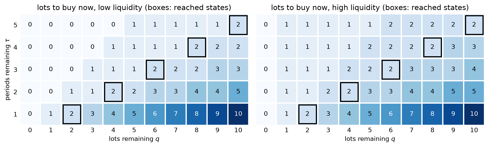
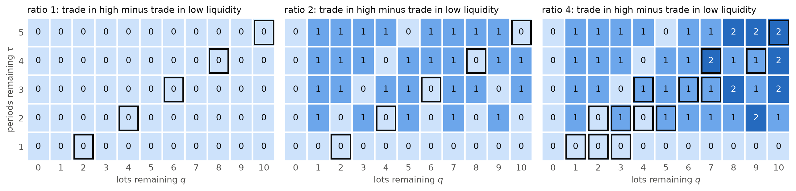

# Optimal Trade Execution Under Changing Liquidity

End-quarter project for **ADSP 32020 Reinforcement Learning** (University of Chicago, MS in Applied Data Science, Autumn 2026, Professor Francisco Azeredo).

**Group 5:** Ahmad Mohammad, Luciano Handal, Robert Scott

## Overview

A trader must buy 10 lots within five periods. Trading is cheaper when the market is liquid, and liquidity switches at random between a low and a high regime. **Does a policy that adapts its trade sizes to the regime cost less than splitting the order equally (TWAP)?**

We write the problem as a finite Markov decision process (MDP), solve it exactly with value iteration, and compare the computed policy with two baselines on the same 10,000 simulated liquidity paths.

Everything is in one notebook, [`optimal_trade_execution.ipynb`](optimal_trade_execution.ipynb).

## Result

**In the base case of our proposal, adapting does not help.** With high liquidity at twice the low level, the optimal policy buys 2 lots in every period on every liquidity path, exactly like TWAP. Both have an expected cost of 15, against 75 for buying all at once.

Expected cost of the whole order, by liquidity ratio:

| Liquidity ratio (high / low) | Optimal policy | TWAP | Buy all at once | Reduction relative to TWAP |
| ---------------------------- | -------------- | ---- | --------------- | -------------------------- |
| 1                            | 20             | 20   | 100             | 0%                         |
| 2 (base case)                | 15             | 15   | 75              | 0%                         |
| 4                            | 11.88          | 12.5 | 62.5            | 4.95%                      |

- **The policy does depend on liquidity.** It spreads the remaining lots evenly and rounds down in low liquidity and up in high liquidity. A 10-lot order over five periods never reaches a state where the two roundings differ (the boxed cells below are the states it reaches).
- **Adapting pays when the two liquidity levels are far enough apart.** At a ratio of 4 the first trade is 3 lots in high liquidity and 1 lot in low liquidity, and the expected cost is 4.95% below TWAP's.
- **A lower expected cost is not a lower cost on every path.** At ratio 4 the optimal policy costs more than TWAP on about 41% of the simulated paths.



The second figure shows how many more lots the policy buys in high liquidity than in low liquidity. Only at ratio 4 does a reached (boxed) state show a difference.



## Problem formulation

| Element            | Definition                                                                                                                                                                                                                                         |
| ------------------ | -------------------------------------------------------------------------------------------------------------------------------------------------------------------------------------------------------------------------------------------------- |
| State              | $(\tau, q, l)$: periods remaining $\tau \in \lbrace 1, \dots, 5 \rbrace$, lots remaining $q \in \lbrace 0, \dots, 10 \rbrace$, liquidity regime $l$ (low or high) with liquidity levels $L_{\text{low}} = 1$ and $L_{\text{high}} = 2$ |
| Start              | $\tau = 5$, $q = 10$, regime low or high with probability $0.5$ each                                                                                                                                                                         |
| Action             | $a \in \lbrace 0, 1, \dots, q \rbrace$, the lots bought now; in the last period the only legal action is $a = q$                                                                                                                               |
| Reward             | $r = -a^2 / L_l$, minus the temporary market-impact cost, in normalized cost units                                                                                                                                                               |
| Transition         | $q' = q - a$ and $\tau' = \tau - 1$; the regime stays the same with probability $0.8$ and switches with probability $0.2$, whatever the trade                                                                                              |
| Terminal condition | the episode ends when $q = 0$; the terminal value is $0$                                                                                                                                                                                       |

The trader sees the regime, trades at that liquidity, and then the regime moves. The model has 110 states, and the regime is its only source of randomness. It is fully specified: nothing is estimated from market data, and the price is constant so that only liquidity matters.

## Method

- **Solver:** synchronous value iteration with a discount factor of 1 and zero initial values. It stops when the largest change of any state value in a sweep is below $10^{-8}$, which happens after six sweeps: each sweep settles the states with one more period remaining.
- **Checks:** exact evaluation of the computed policy gives back the values from value iteration, the vectorized simulator and the Gymnasium environment give the same cost on all 32 possible liquidity paths, and the simulated mean cost is within 4 standard errors of the exact expected cost.
- **Baselines:** TWAP (2 lots per period) and buying all 10 lots at once.
- **Evaluation:** exact expected costs, and 10,000 simulated liquidity paths shared by all policies (mean cost, reduction relative to TWAP, cost distributions).
- **Sensitivity:** liquidity ratios of 1, 2 and 4.

## How to run

With [uv](https://docs.astral.sh/uv/):

```
git clone https://github.com/ahmedas91/rl-optimal-trade-execution.git
cd rl-optimal-trade-execution
uv sync
uv run jupyter lab optimal_trade_execution.ipynb
```

`uv sync` creates `.venv` with Python 3.12 and the exact package versions recorded in `uv.lock`. Then run all cells from the top. The notebook needs no data download and no GPU, and it finishes in well under a minute.

A run rewrites `data/liquidity_paths.csv`, `results/optimal_policy.csv` and the figures. The random draws use a fixed seed, so the numbers are the same on every run with the locked package versions.

## Repository contents

| Path                                                 | Content                                                                                                 |
| ---------------------------------------------------- | ------------------------------------------------------------------------------------------------------- |
| `optimal_trade_execution.ipynb`                    | The project: model, environment, solver, results and demonstration                                      |
| `data/liquidity_paths.csv`                         | Raw data: the 10,000 simulated liquidity paths, one column per period (0 = low, 1 = high)               |
| `results/optimal_policy.csv`                       | The computed policy and value of every state for liquidity ratios 1, 2 and 4 (regime 0 = low, 1 = high) |
| `results/figures/`                                 | The figures of the notebook                                                                             |
| `pyproject.toml`, `uv.lock`, `.python-version` | The Python environment for uv                                                                           |
| `requirements.txt`                                 | The same pinned versions for pip, exported from `uv.lock`                                             |

## References

1. Almgren, R. (2012). Optimal trading with stochastic liquidity and volatility. *SIAM Journal on Financial Mathematics*, 3(1), 163–181. https://doi.org/10.1137/090763470
2. Almgren, R., & Chriss, N. (2001). Optimal execution of portfolio transactions. *The Journal of Risk*, 3(2), 5–39. https://doi.org/10.21314/JOR.2001.041
3. Bertsimas, D., & Lo, A. W. (1998). Optimal control of execution costs. *Journal of Financial Markets*, 1(1), 1–50. https://doi.org/10.1016/S1386-4181(97)00012-8
4. Cheridito, P., & Sepin, T. (2014). Optimal trade execution under stochastic volatility and liquidity. *Applied Mathematical Finance*, 21(4), 342–362. https://doi.org/10.1080/1350486X.2014.881005
5. Nevmyvaka, Y., Feng, Y., & Kearns, M. (2006). Reinforcement learning for optimized trade execution. *Proceedings of the 23rd International Conference on Machine Learning*, 673–680. https://doi.org/10.1145/1143844.1143929
6. Puterman, M. L. (1994). *Markov Decision Processes: Discrete Stochastic Dynamic Programming*. Wiley. https://doi.org/10.1002/9780470316887
7. Sutton, R. S., & Barto, A. G. (2018). *Reinforcement Learning: An Introduction* (2nd ed.). MIT Press.
8. Towers, M., Kwiatkowski, A., Balis, J., et al. (2025). Gymnasium: A standard interface for reinforcement learning environments. *Advances in Neural Information Processing Systems 38*, 163114–163129. https://doi.org/10.52202/085713-4916
